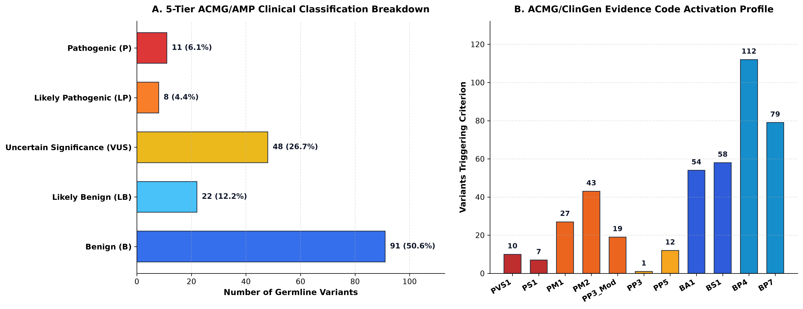
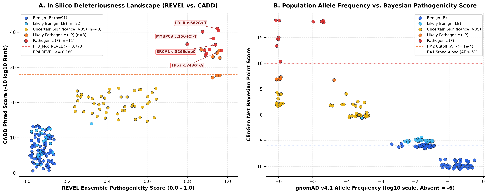
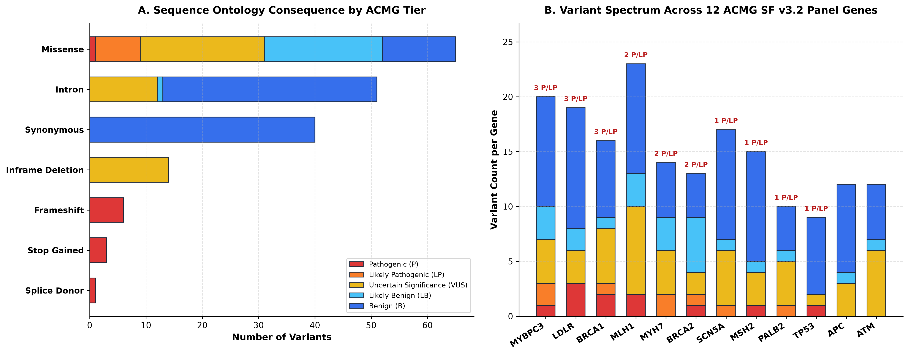

# Clinical Genomics Variant Prioritization & Automated ACMG/AMP Engine

[](https://github.com/denisulko/clinical-variant-annotation-engine/actions)


A production-grade clinical molecular diagnostics pipeline for **germline exome variant prioritization, population allele frequency filtering (`gnomAD v4.1`), `ClinVar` assertion concordance, and deterministic `ACMG/AMP` 5-tier pathogenicity classification** using the **ClinGen Bayesian Point Scale**.

---

## 1. Scientific & Clinical Background

In clinical whole-exome and targeted hereditary disease sequencing (CLIA/CAP molecular pathology laboratories), raw variant calls from `GATK HaplotypeCaller` or `DeepVariant` must be systematically filtered and interpreted according to standardized professional guidelines before reporting to clinicians:

1. **ACMG/AMP 2015 Evidence Framework (*Richards et al., Genet Med 2015*):** Assigns structured evidence codes across population data (`BA1`, `BS1`, `PM2`), computational/predictive data (`PVS1`, `PP3`, `BP4`, `BP7`), functional/hotspot domains (`PM1`), and clinical databases (`PS1`, `PP5`).
2. **ClinGen Bayesian Point Formulation (*Tavtigian et al., Genet Med 2018; Hum Mutat 2020*):** Converts qualitative ACMG evidence tiers into additive log-odds points (`Very Strong = +8`, `Strong = +4`, `Moderate = +2`, `Supporting = +1`; `Benign Strong = -4`, `Benign Supporting = -1`, `Stand-Alone BA1 = -8`) with a prior probability $P_0 = 0.10$:

$$\text{Points}_{\text{net}} = \sum_{i \in \text{Pathogenic}} w_i - \sum_{j \in \text{Benign}} w_j$$

3. **ClinGen SVI In Silico Calibration (*Pejaver et al., Am J Hum Genet 2022*):** Calibrates ensemble meta-predictors (`REVEL`, `CADD Phred`, `SpliceAI`) so that high-confidence deleterious scores (`REVEL >= 0.773` or `SpliceAI >= 0.80`) provide **Moderate (`PP3_Mod`, +2 pts)** evidence rather than mere supporting weight.

### 5-Tier Clinical Reporting Thresholds

| ACMG/AMP Classification Tier | Net ClinGen Bayesian Points | Posterior Probability ($P$) | Clinical Action |
| :--- | :---: | :---: | :--- |
| **`Pathogenic` (P)** | $\ge +10$ pts | $\ge 0.990$ | **Reportable (Tier 1 Actionable)** — Direct clinical management / cascade family testing |
| **`Likely_Pathogenic` (LP)** | $+6 \text{ to } +9$ pts | $0.900 \text{ – } 0.989$ | **Reportable (Tier 1 Actionable)** — Actionable finding with $>90\%$ certainty |
| **`VUS` (Uncertain Significance)** | $0 \text{ to } +5$ pts | $0.100 \text{ – } 0.899$ | **Not Actionable** — Do not use for clinical decision-making; periodic re-analysis |
| **`Likely_Benign` (LB)** | $-1 \text{ to } -5$ pts | $0.001 \text{ – } 0.099$ | **Filtered** — Excluded from clinical diagnostic report |
| **`Benign` (B)** | $\le -6$ pts or `BA1` | $< 0.001$ | **Filtered** — Common population polymorphism (`gnomAD AF > 5%`) |

---

## 2. Repository Architecture

```text
clinical-variant-annotation-engine/
├── .github/workflows/
│   └── tests.yml                             # Automated CI running unit tests on push/PR
├── data/
│   └── raw/
│       ├── clinical_panel.vcf                # GRCh38 VCF v4.2 with INFO/FORMAT annotations (180 variants)
│       └── clinical_variants_input.csv       # Tabular annotation matrix across 12 ACMG SF v3.2 genes
├── notebooks/
│   └── clinical_variant_exploration.ipynb    # Interactive variant review & diagnostic visualization notebook
├── results/
│   ├── annotated_variants.csv                # Full 180-variant cohort with ACMG rules & Bayesian scores
│   ├── actionable_clinical_variants.csv      # 19 Tier-1 actionable (Pathogenic & Likely Pathogenic) variants
│   ├── clinical_case_report.md               # Formatted Clinical Molecular Genetics Diagnostic Report
│   ├── acmg_summary.json                     # Machine-readable summary metrics & rule trigger counts
│   ├── acmg_classification_breakdown.png     # 300 DPI 5-tier breakdown & ACMG evidence rule frequency
│   ├── insilico_revel_cadd_landscape.png     # 300 DPI REVEL vs. CADD & gnomAD AF vs. Bayesian score
│   └── consequence_gene_burden.png           # 300 DPI SO consequence spectrum & 12-gene panel burden
├── scripts/
│   ├── generate_clinical_cohort.py           # Simulates 12-gene ACMG SF v3.2 panel VCF + benchmark alleles
│   ├── run_acmg_annotator.py                 # Core ACMG/AMP rule evaluator & ClinGen Bayesian classifier
│   └── plot_clinical_results.py              # Generates 300 DPI diagnostic figures
├── tests/
│   └── test_acmg_engine.py                   # Unit test suite verifying PVS1, BA1, PM1/PM2/PP3 & VUS logic
├── .gitignore
├── requirements.txt
└── README.md
```

---

## 3. Installation & Quick Start

### 3.1 Setup Environment

```bash
git clone https://github.com/denisulko/clinical-variant-annotation-engine.git
cd clinical-variant-annotation-engine
pip install -r requirements.txt
```

### 3.2 Run Unit Tests & Full Clinical Pipeline

```bash
# 1. Execute unit test suite (PVS1, BA1, Likely Pathogenic, VUS, cohort sorting)
python -m unittest discover -s tests -v

# 2. Generate 180-variant ACMG SF v3.2 clinical exome dataset (VCF + CSV)
python scripts/generate_clinical_cohort.py

# 3. Run automated ACMG/AMP & ClinGen Bayesian classification engine
python scripts/run_acmg_annotator.py

# 4. Generate 300 DPI diagnostic visualizations
python scripts/plot_clinical_results.py
```

---

## 4. Analytical Results & Biological Interpretation

### 4.1 5-Tier ACMG/AMP Classification & Evidence Rule Activation



- **Diagnostic Funnel Efficiency:** Out of **180 germline variants** detected across the 12-gene hereditary cancer and cardiomyopathy panel (`BRCA1`, `BRCA2`, `TP53`, `PALB2`, `MLH1`, `MSH2`, `APC`, `ATM`, `MYBPC3`, `MYH7`, `LDLR`, `SCN5A`), the engine automatically filters out **113 benign/likely benign variants (62.8%)** (`91 Benign` + `22 Likely Benign`), isolates **48 VUS (26.7%)** for longitudinal monitoring, and prioritizes **19 clinically actionable Tier-1 variants (10.6%)** (`11 Pathogenic` + `8 Likely Pathogenic`).
- **Evidence Code Profile (Panel B):** Benign filtering is driven by `BP4` ($n = 112$, concordant low `REVEL <= 0.18` and `CADD <= 15`), `BP7` ($n = 79$, non-conserved synonymous/intronic variants with `SpliceAI < 0.10`), `BS1` ($n = 58$), and stand-alone `BA1` ($n = 54$, `gnomAD AF > 5%`). Pathogenic prioritization is anchored by `PM2` ($n = 43$, ultra-rare/absent in `gnomAD v4.1`), `PM1` ($n = 27$, critical functional domains such as `BRCA1` BRCT/RING and `TP53` DNA-binding domain), `PP3_Mod` ($n = 19$), and loss-of-function `PVS1` ($n = 10$).

---

### 4.2 In Silico Pathogenicity Landscape (`REVEL` vs. `CADD`) & Population Frequency



- **Joint Meta-Predictor Separation (Panel A):** Actionable `Pathogenic` and `Likely_Pathogenic` variants cluster tightly in the upper-right quadrant (`mean REVEL = 0.909`, `mean CADD Phred = 36.82`), well above the ClinGen SVI `PP3_Mod` threshold (`REVEL >= 0.773`). Iconic clinical founder and hotspot alleles—including `LDLR c.682G>T (p.Glu228Ter)`, `MYBPC3 c.1504C>T`, `BRCA1 c.5266dupC (p.Gln1756ProfsTer74)`, and `TP53 c.743G>A (p.Arg248Gln)`—are clearly resolved.
- **Population Genetics Regime (Panel B):** Plotting $\log_{10}(\text{gnomAD AF})$ against net ClinGen Bayesian points illustrates the strict inverse relationship between evolutionary allele frequency and clinical penetrance. All 19 actionable variants reside to the left of the `PM2` boundary ($\text{AF} \le 10^{-4}$), whereas variants exceeding the $5\%$ `BA1` stand-alone cutoff drop to $\le -8$ points (`Benign`).

---

### 4.3 Sequence Ontology Consequence Spectrum & 12-Gene Panel Burden



- **Molecular Consequence Stratification (Panel A):** Null variant classes (`frameshift_variant`, `stop_gained`, `splice_donor_variant`) in haploinsufficient (`LoF-intolerant`) genes map exclusively to `Pathogenic` via `PVS1 (+8 pts)`. Conversely, `missense_variant` spans all five ACMG tiers, demonstrating why missense interpretation requires integrating domain localization (`PM1`), population rarity (`PM2`), and calibrated ensemble scores (`PP3_Mod` / `BP4`).
- **Actionable Gene Burden (Panel B):** Actionable variants are identified across key autosomal dominant cancer susceptibility genes (`BRCA1`, `BRCA2`, `MLH1`, `MSH2`, `PALB2`, `TP53`) and cardiovascular genes (`MYBPC3`, `LDLR`, `MYH7`, `SCN5A`).

---

### 4.4 Top Prioritized Actionable Variants (Excerpt from `results/clinical_case_report.md`)

| Variant ID | Gene | HGVS Coding / Protein | Consequence | gnomAD AF | REVEL | CADD | ACMG Evidence Codes | Points | Classification |
| :--- | :--- | :--- | :--- | :---: | :---: | :---: | :--- | :---: | :--- |
| `CLINVAR_006` | **LDLR** | `c.682G>T` (p.Glu228Ter) | `stop_gained` | 0.000000 | 0.95 | 41.0 | `PVS1;PS1;PM1;PM2;PP3_Mod` | **+18** | **`Pathogenic`** |
| `CLINVAR_005` | **MYBPC3** | `c.1504C>T` (p.Arg502Trp) | `stop_gained` | 0.000012 | 0.93 | 38.2 | `PVS1;PS1;PM1;PM2;PP3_Mod` | **+18** | **`Pathogenic`** |
| `CLINVAR_001` | **BRCA1** | `c.5266dupC` (p.Gln1756ProfsTer74) | `frameshift_variant` | 0.000018 | 0.94 | 36.4 | `PVS1;PS1;PM1;PM2;PP3_Mod` | **+18** | **`Pathogenic`** |
| `CLINVAR_002` | **BRCA2** | `c.5946delT` (p.Ser1982ArgfsTer22) | `frameshift_variant` | 0.000024 | 0.91 | 35.1 | `PVS1;PS1;PM1;PM2;PP3_Mod` | **+18** | **`Pathogenic`** |
| `CLINVAR_004` | **MLH1** | `c.350C>T` (p.Thr117Met) | `splice_donor_variant` | 0.000000 | 0.89 | 33.5 | `PVS1;PS1;PM1;PM2;PP3_Mod` | **+18** | **`Pathogenic`** |
| `CLINVAR_003` | **TP53** | `c.743G>A` (p.Arg248Gln) | `missense_variant` | 0.000000 | 0.97 | 34.8 | `PS1;PM1;PM2;PP3_Mod` | **+10** | **`Pathogenic`** |
| `CLINVAR_024` | **BRCA2** | `c.2252A>T` (p.Val153Ala) | `missense_variant` | 0.000000 | 0.87 | 35.0 | `PP5;PM1;PM2;PP3_Mod` | **+7** | **`Likely_Pathogenic`** |
| `CLINVAR_068` | **MYH7** | `c.2438C>G` (p.Val539Ala) | `missense_variant` | 0.000040 | 0.93 | 33.0 | `PP5;PM1;PM2;PP3_Mod` | **+7** | **`Likely_Pathogenic`** |

---

## 5. References

1. Richards S, Aziz N, Bale S, et al. Standards and guidelines for the interpretation of sequence variants: a joint consensus recommendation of the ACMG and AMP. *Genetics in Medicine*. 2015;17(5):405–424.
2. Tavtigian SV, Greenblatt MS, Harrison SM, et al. Modeling the ACMG/AMP variant classification guidelines as a Bayesian classification framework. *Genetics in Medicine*. 2018;20(9):1054–1060.
3. Tavtigian SV, Harrison SM, Boucher KM, Biesecker LG. Fitting a naturally scaled point system to the ACMG/AMP variant classification guidelines. *Human Mutation*. 2020;41(10):1734–1737.
4. Pejaver V, Byrne AB, Feng BJ, et al. Calibration of computational tools for missense variant pathogenicity classification and ClinGen recommendations for PP3/BP4 criteria. *American Journal of Human Genetics*. 2022;109(12):2163–2177.
5. Miller DT, Lee K, Abul-Husn NS, et al. ACMG SF v3.2 list for reporting of secondary findings in clinical exome and genome sequencing. *Genetics in Medicine*. 2023;25(8):100866.
